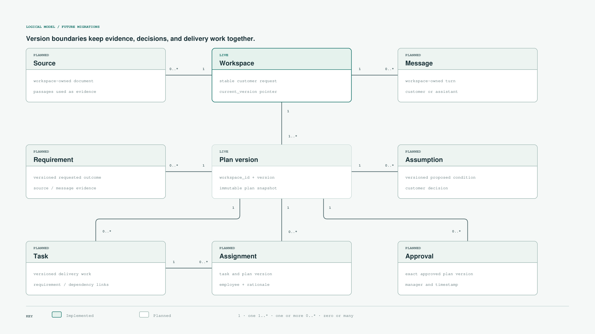
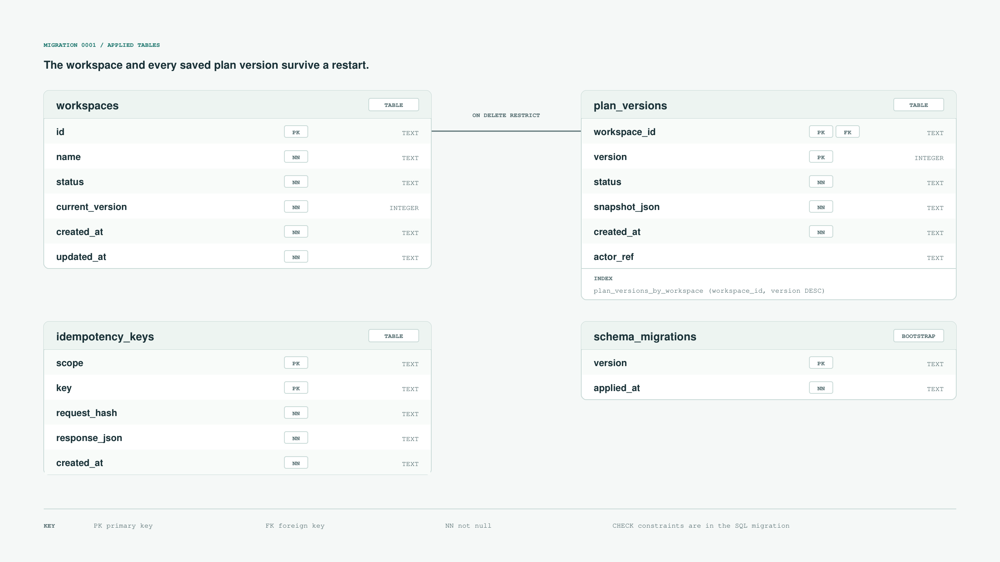

# CLARVIO

**Turn a customer request into a reviewable delivery plan.**

CLARVIO is an AI-assisted workspace for understanding a customer's request before committing to delivery. The intended first release lets a customer upload requirements, clarify them in chat, and approve explicit assumptions. It then proposes tasks, a timeline, and suitable employees while balancing workload across the team. A manager reviews the plan before the customer receives an approved commitment and an exportable task file. Google Sheets and Jira connections are possible later integrations.

## How it works


The [product description](docs/project-description/pd.md) explains the workflow, user roles, and approval boundary. Employee skills, availability, workload, and historical tasks are mock data in this prototype.

## What is built today

The current code implements the persistent Workspace foundation from [ticket #13](https://github.com/ToiLaKiet/clarivo/issues/13): create a Workspace, save a request summary as a new Plan version, reopen it after a restart, and inspect its version history. Writes use transactions, expected versions, and idempotency keys. Document upload, AI clarification, task planning, employee matching, approval, and export are the next product slices. Workspace access control is planned in [ticket #1](https://github.com/ToiLaKiet/clarivo/issues/1) before shared customer use.

## Tech stack

| Layer | Technology | Role |
| --- | --- | --- |
| Frontend | HTML, CSS, vanilla JavaScript | Workspace UI in `frontend/` |
| Backend | Python, FastAPI, Uvicorn | API and persistence logic in `backend/` |
| Database | SQLite, numbered SQL migrations | Durable Workspaces and Plan versions in `database/` |
| Tests | pytest, HTTPX | API and persistence checks in `tests/` |

## Data model

The planned model connects customer evidence and decisions to a specific Plan version. Only Workspace and Plan version are implemented today.



The current SQLite schema contains Workspaces, immutable Plan-version snapshots, idempotency records, and migration history.



See the [database ADR](docs/adr/0001-versioned-workspace-store.md) for the design rationale and the [HTML diagram](docs/diagrams/database-model.html) for both views. The [glossary](GLOSSARY.md) defines the domain terms.

## Run locally

From the repository root:

```bash
pip install -r requirements.txt
uvicorn backend.app:app --reload
```

Open the [Workspace UI](http://127.0.0.1:8000) or [API docs](http://127.0.0.1:8000/docs). SQLite data defaults to `database/data/clarivo.sqlite3`; set `CLARVIO_DB` to use another path. To run tests: `pip install -r requirements-dev.txt && python3 -m pytest -q`.
