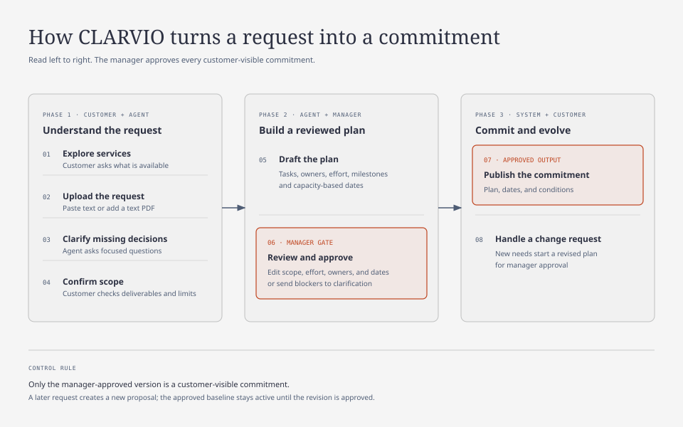
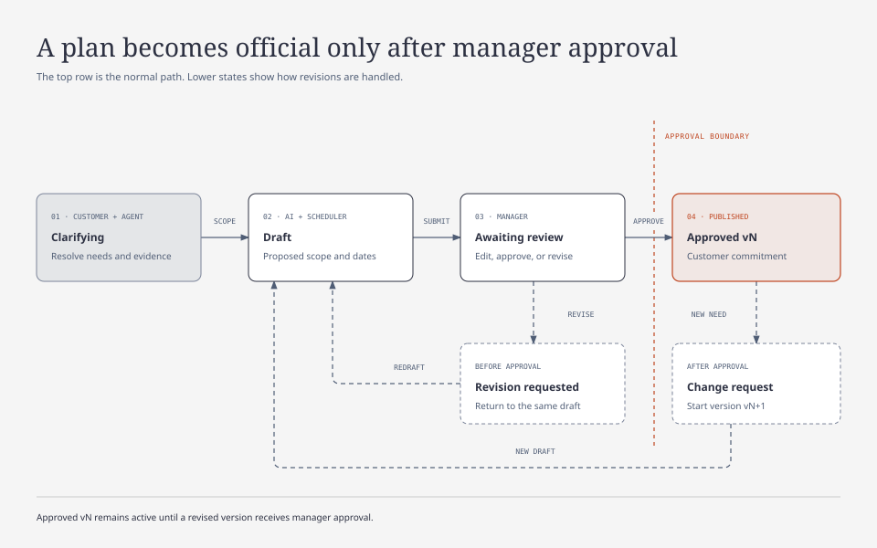

# CLARVIO

> **Client Requirements & Delivery Commitment Agent**

## Product overview

CLARVIO is a customer-facing AI workspace that turns requirement documents and conversations into a delivery plan that a manager reviews and approves before commitment.

Customers upload files and brainstorm with the agent to clarify their needs. The agent proposes tasks, suitable employees, effort ranges, and a delivery timeline. A manager then reviews and approves the scope, effort, assignments, and customer-visible dates.

**Product goal:** Produce a reviewed delivery commitment with clear deliverables, acceptance criteria, milestones, exclusions, and conditions.

> **Prototype limitation**
>
> All employee profiles, skills, availability, workloads, and historical task records are mocked. Assignments and timelines demonstrate the workflow; they do not establish real-world estimation accuracy. Manager approval represents a simulated delivery commitment.

## Problem

Before committing to a client, teams must interpret requirements, resolve missing details, estimate effort, and identify people with enough capacity. These decisions often happen separately and depend on individual judgment. CLARVIO connects them in one reviewable workflow.

## Users and authority

| User | Responsibilities |
| --- | --- |
| **Customer** | Ask product or service questions, upload requirements, answer clarification questions, and confirm the requested scope. |
| **AI agent** | Explain services, clarify requirements, and propose scope, tasks, assignments, estimates, and milestones. |
| **Manager** | Review, edit, and approve scope, effort, assignments, and customer-visible dates; approve subsequent changes. |

Employee records support planning. A separate employee portal is a later feature.

## Inputs and outputs

| Inputs | Outputs |
| --- | --- |
| Approved product or service documentation | Grounded answers with source references |
| Requirement files and customer conversations | Requirements, supporting evidence, acceptance criteria, and clarification questions |
| Mock employee skills, availability, and workloads | Suggested task owners, matching reasons, and capacity conflicts |
| Mock historical tasks, effort assumptions, dependencies, and calendars | Proposed effort ranges, milestones, and delivery timeline |
| Manager edits and approvals | Versioned, approved delivery plan |
| Customer changes after approval | Change request with affected requirements, tasks, and proposed scheduling impact |

## Core workflow

1. **Explore:** The customer asks questions about the company's products or services.
2. **Upload:** The customer submits pasted text or a text-based PDF describing the request.
3. **Clarify:** The agent asks focused questions, suggests options with trade-offs, and records confirmed decisions.
4. **Confirm scope:** The customer checks the requirements, deliverables, acceptance criteria, exclusions, and assumptions.
5. **Draft plan:** The agent proposes tasks, dependencies, employees, and effort ranges. Scheduling code calculates dates from capacity and working calendars.
6. **Manager review:** The manager edits and approves scope, effort, assignments, and dates. Unresolved blockers return to clarification.
7. **Publish commitment:** The customer receives the manager-approved plan and its conditions.
8. **Handle changes:** New requirements become change requests. The existing commitment remains in place until a revised plan is approved.

## Main features

### Conversational requirement clarification

The agent reads uploaded documents and asks a few useful questions at a time. It prioritizes missing decisions that could change scope or effort and remembers answers already confirmed. Extracted requirements link to source passages or customer messages.

Customer requests, agent suggestions, and confirmed decisions remain distinguishable. Missing information is never silently converted into an assumption.

### Product and service guidance

Answers use approved company material. The agent distinguishes current capabilities from requested custom work and escalates questions it cannot answer.

### Employee matching and effort proposals

Proposed task owners are matched against mock skills, experience, availability, and workload. Suggestions include reasons and conflicts. The agent presents effort ranges and assumptions for manager review instead of treating generated numbers as facts.

### Delivery timeline

A simple timeline shows tasks, owners, dependencies, milestones, and the proposed completion date or range. Scheduling respects available hours and working days. Effort and elapsed duration are displayed separately.

### Manager approval and version history

Plans progress through **Clarifying → Draft → Awaiting manager review → Approved**. The manager can request revisions. Every published commitment records its plan version, approver, approval time, scope, schedule, and conditions.

Customers can see preliminary plans when useful, clearly marked as unapproved. The approved plan is the product's final output. Approval establishes accountability; it does not make a date unconditional or guaranteed.

## Standout features

| Feature | Customer or team benefit |
| --- | --- |
| **Impact-ranked questions** | Resolve the decisions most likely to affect delivery first. |
| **Requirement-to-timeline traceability** | Explain how a customer answer affects tasks, owners, and milestones. |
| **Capacity-aware employee matching** | Account for available time as well as skills. |
| **Visible approval status** | Make it clear which dates are proposals and which the manager has approved. |
| **Change impact preview** | Show what a new request could change before accepting it. |

> **Primary differentiator:** One connected path from customer conversation to a manager-approved delivery commitment.

## First-release scope

The product accepts different kinds of task requests rather than enforcing a single service category. Detailed planning depends on the available company information, skill definitions, and task templates. Requests outside that coverage are flagged for manager assessment; broad input support is not a claim of equally reliable estimation across all domains.

### Urgent MVP

- Product or service chat backed by curated company documentation.
- Pasted text and text-based PDF uploads.
- Iterative clarification and editable, evidence-linked requirements.
- Customer scope confirmation.
- Mock employee directory, availability, workload, and historical tasks.
- Proposed tasks, owners, dependencies, and effort ranges.
- A basic delivery timeline.
- Manager editing, approval, publication, and plan version history.
- A basic change-request flow that preserves the approved baseline.
- Markdown export of the approved plan.

### Later features

- Richer change-impact analysis.
- Side-by-side planning scenarios.
- Employee task updates.
- Calendar and project-tool integrations.
- Estimation calibration using real delivery outcomes.

### Outside the first release

- Autonomous commitments or assignments.
- Guaranteed dates.
- Legally binding contract generation.
- Fixed-price quotations.
- Payments.
- Scanned-document OCR.
- A complete project management suite.

## LLM Ops scope

Start with hosted LLM APIs and keep keys on the backend.

| Capability | Application |
| --- | --- |
| **Structured output** | Schema validation for requirements, questions, tasks, and assignment proposals |
| **Versioning** | Record prompt version, model, and application version for each run |
| **Evaluation** | Build 200+ labeled cases for extraction, evidence, clarification, and unsupported claims; distinguish synthetic examples from real data |
| **CI gate** | Block evaluated quality regressions and test scheduling constraints with ordinary code |
| **Tracing and metrics** | Measure model calls, retries, end-to-end latency, errors, tokens, and cost |
| **Reliability** | Apply timeouts, bounded retries, rate limits, and input limits; support a second provider with tested failover |
| **Rollback** | Restore a previous prompt or configuration version and demonstrate the rollback |

Set latency, success-rate, and cost targets after measuring the baseline. Validate the complete service under load rather than relying on individual model-call timings.

## Success measures

- Requirement coverage and correctness of supporting evidence.
- Clarification usefulness and missed critical questions, scored with a review rubric.
- Time from initial upload to manager approval.
- Assignment validity and scheduling conflicts against mock constraints.
- Correct enforcement of manager approval and plan version boundaries.
- End-to-end p95 latency, valid-response rate, fallback rate, and cost per completed assessment.

> Real-world estimate accuracy requires real completed-project data. Mock records can validate calculations and demonstrate comparisons, but cannot prove predictive performance.

## Demo scenario

A customer uploads a booking-system brief. The agent clarifies payment rules, cancellations, and multiple-location support. The customer confirms the scope. Using mock employee and task records, the agent proposes assignments and effort ranges, and the scheduler drafts milestones. The manager adjusts the plan and approves it. The customer sees the approved delivery commitment. A later feature request creates a separate revision proposal requiring renewed approval.
