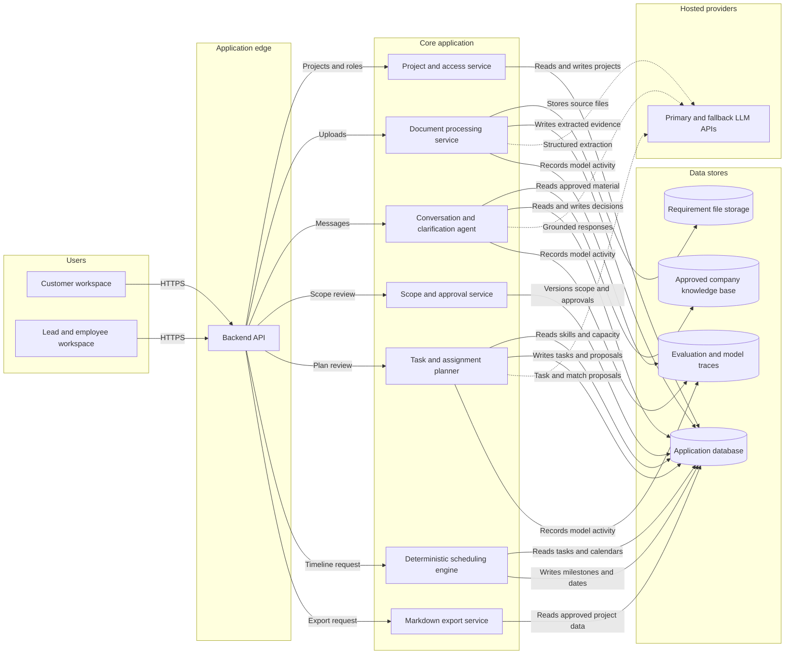

Clarivo

# Client Requirements & Delivery Planning Agent

## Product description

A customer-facing workspace where customers learn about our services, upload requirement documents, and brainstorm with an AI agent. The agent helps clarify what should be built, proposes suitable employees for the work, and drafts a delivery timeline for the team to review.

**Core workflow:** Upload requirements → clarify through conversation → confirm scope → propose tasks and employees → review estimates → publish a delivery timeline.

## Product flow

```mermaid
flowchart LR
    start([Customer starts project]) --> discover[Explore services and ask questions]
    discover --> upload[/Upload requirements/]
    upload --> extract[Extract requirements and supporting evidence]
    extract --> clarify[Clarify high-impact decisions]
    clarify --> ready{Scope ready for review?}
    ready -->|No| clarify
    ready -->|Yes| scope[Edit and confirm scope]
    scope --> approveScope{Internal scope approval?}
    approveScope -->|Changes requested| clarify
    approveScope -->|Approved| plan[Propose tasks, effort ranges, and employees]
    plan --> teamReview[Lead and employees review estimates and capacity]
    teamReview --> feasible{Plan feasible?}
    feasible -->|No| plan
    feasible -->|Yes| schedule[Calculate dependencies, dates, and milestones]
    schedule --> publish[Manager publishes delivery timeline]
    publish --> change{Customer requests a change?}
    change -->|No| finish([Approved delivery baseline])
    change -->|Yes| impact[Preview scope, task, assignment, and date impact]
    impact --> scope
```

## Conceptual MVP architecture

This is a technology-neutral view. Service boundaries can initially be modules in one backend rather than independently deployed microservices.

## Problem

Client requests often leave important decisions unstated. Teams spend time interpreting documents, chasing answers, estimating effort, and finding available employees. When these decisions are disconnected, customers can receive commitments that do not reflect the actual scope or team capacity.

## Users

- **Customers:** explore services, submit requirements, answer questions, and review scope and delivery milestones.
- **Project managers or technical leads:** resolve open decisions, approve task assignments and estimates, and publish commitments.
- **Employees:** review proposed tasks, confirm availability and effort, and report progress.

## Inputs and outputs

| Inputs | Outputs |
|---|---|
| Approved product/service documentation and policies | Answers grounded in company information, with source references |
| Customer requirement files and chat responses | Structured requirements, acceptance criteria, assumptions, and unresolved questions |
| Employee skills, roles, availability, and existing commitments | Suggested employees per task, with matching reasons and capacity conflicts |
| Task dependencies, reviewed effort ranges, and working calendars | Proposed milestones, delivery date range, and timeline |
| Approved scope and later customer revisions | Scope changes and their potential impact on tasks and dates |

## Main features

### 1. Product and service conversation

Customers ask what the company can deliver and how its services work. The agent answers from approved company material and escalates questions it cannot answer. It must distinguish existing capabilities from new features requested by a customer.

### 2. Requirement upload and analysis

Customers paste text or upload text-based PDFs. The agent extracts goals, deliverables, constraints, and requirements, linking each extracted requirement to its supporting passage. Missing information remains explicitly unresolved.

### 3. Guided clarification and brainstorming

The agent asks a few relevant questions at a time, prioritizing decisions that affect scope, architecture, or effort. It offers options with tradeoffs and remembers confirmed answers instead of repeatedly asking the same questions.

**Example:** For a booking system, ask whether bookings need manual approval, how cancellations work, and whether multiple locations are supported. Separate customer requests, agent suggestions, and confirmed decisions.

### 4. Scope confirmation

The conversation becomes an editable scope containing deliverables, acceptance criteria, exclusions, assumptions, and remaining blockers. The customer and internal lead review it before it becomes an approved baseline.

### 5. Employee matching

The agent proposes employees using relevant skills, experience, availability, and current workload. Each suggestion explains the match and identifies missing skills or capacity. Managers approve assignments; employees can flag inaccurate availability or estimates.

### 6. Effort estimation and delivery timeline

The agent proposes a task breakdown and effort ranges with assumptions. Employees or leads review those ranges. Scheduling code then uses dependencies, capacity, and working calendars to calculate feasible dates and milestones.

Customers see the proposed finish date range, unresolved decisions, and the assumptions behind it. The manager publishes the approved plan. Later changes generate a revised proposal rather than silently changing an agreed deadline.

## Standout features

| Feature | Value |
|---|---|
| **Impact-ranked questions** | Resolve decisions most likely to change effort or design first |
| **Requirement-to-timeline traceability** | Follow a customer answer through its requirement, tasks, proposed owners, and milestones |
| **Conditional plans** | Compare alternatives such as a basic launch versus an expanded scope and show their scheduling implications |
| **Capacity-aware assignments** | Suggest people who have both the skills and available time |
| **Scope change impact preview** | Show which tasks, assignments, and dates may change before approving a new request |

**Recommended differentiator:** a customer can see how a clarified requirement changes the proposed delivery plan, with a clear explanation and an approval step.

## Urgent MVP

Focus on one service category, such as small web application projects.

1. Customer chat with a curated company knowledge base.
2. Pasted text and text-based PDF uploads.
3. Evidence-linked requirement extraction and iterative clarification.
4. Editable scope summary with customer confirmation and internal approval.
5. Manually maintained employee skills and availability.
6. Proposed task assignments and effort ranges, reviewed by a lead.
7. Simple dependency-based milestone timeline with proposed and approved states.
8. Saved conversation, scope versions, and Markdown export.

The complete upload-to-timeline workflow belongs in the MVP, but employee data and estimation review can remain manual initially.

## Later features and exclusions

**Later:** automated scope comparison, historical estimate calibration, employee task updates, calendar/project-tool integrations, and richer scenario comparisons.

**Outside the first release:** automatic contractual commitments, guaranteed delivery dates, autonomous employee assignment, fixed-price quotations, payments, scanned-document OCR, and full project management functionality.

## Planning constraints

- Clear requirements alone cannot establish reliable duration; team capability and delivery history also matter.
- Effort hours differ from elapsed time. An eight-hour task can span several days when its owner has limited availability.
- Dependencies, testing, integration, customer approval, and rework must appear in the plan.
- With little historical data, estimates must be labeled provisional and reviewed by the team.
- Track scope changes and waiting time separately when comparing estimates with actual outcomes.
- Treat uploaded documents as source material, not instructions that can override agent behavior. Keep customer data separated between projects.

## LLM Ops implementation

Start with hosted LLM APIs and keep API keys on the backend.

| Capability | Implementation goal |
|---|---|
| Structured responses | Validate requirements, questions, tasks, and proposed assignments against schemas |
| Versioning | Record prompt version, model, and application version for each assessment |
| Evaluation | Build 200+ labeled cases covering extraction, evidence, clarification, and unsupported claims |
| Release gates | Block changes that regress evaluated quality; check scheduling constraints with ordinary code |
| Observability | Trace document processing and model calls; measure latency, errors, tokens, and cost |
| Reliability | Add bounded retries, timeouts, a second provider, and a tested failover drill |
| Rollback | Restore a previous prompt/configuration version without rebuilding |

## Success measures

- Time from initial upload to an approved scope.
- Requirement coverage and correctness of supporting evidence.
- Human review score for clarification usefulness and missed blockers.
- Percentage of proposed assignments accepted and number of scheduling conflicts.
- Estimate range coverage against actual effort once completed-project data exists.
- End-to-end p95 latency, valid-response rate, fallback rate, and cost per completed assessment.

## Example demo

A customer uploads a booking website brief. The agent answers service questions and clarifies payment, cancellation, and location rules. The customer confirms the resulting scope. The agent proposes tasks and suitable employees; a lead reviews effort and capacity. The system produces a proposed milestone timeline, which the manager approves and shares with the customer.

## Decisions still to validate

- Which service category should the first version support?
- What employee availability and historical task data can the team provide?
- Who approves scope, effort, assignments, and customer-visible dates?
- Is the customer's priority a quick preliminary plan or a reviewed delivery commitment?
